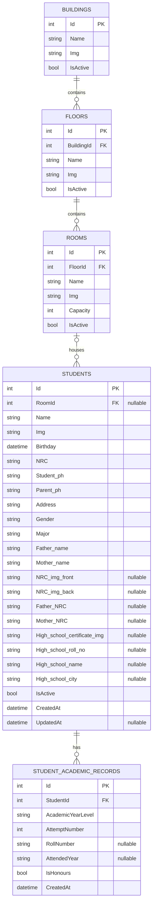

# Hostel Management System Database ERD

## Overview

The current SQLite database contains five Entity Framework Core entities:

- `Buildings`
- `Floors`
- `Rooms`
- `Students`
- `StudentAcademicRecords`

The database is configured in `Database/AppDbContext.cs` and is stored at:

```text
%AppData%\HostelManagementSystem\hostel.db
```

The application creates the database with `EnsureCreated()` during startup. The current project does not contain EF Core migration files.

## Entity Relationship Diagram



## Relationships

### Building to Floor

```text
One Building
	└── Zero or many Floors
```

- Foreign key: `Floors.BuildingId` → `Buildings.Id`
- Delete behavior configured in EF Core: cascade
- Application behavior: buildings are normally soft-deleted by setting `IsActive = false`

### Floor to Room

```text
One Floor
	└── Zero or many Rooms
```

- Foreign key: `Rooms.FloorId` → `Floors.Id`
- Delete behavior configured in EF Core: cascade
- Application behavior: deleting a floor also marks its rooms inactive

### Room to Student

```text
One Room
	└── Zero or many Students
```

- Foreign key: `Students.RoomId` → `Rooms.Id`
- `RoomId` is nullable, so a student may exist without a room
- Delete behavior configured in EF Core: `SetNull`
- Deleting a room does not delete the student record

### Student to StudentAcademicRecord

```text
One Student
	└── Zero or many StudentAcademicRecords
```

- Foreign key: `StudentAcademicRecords.StudentId` → `Students.Id`
- Delete behavior configured in EF Core: cascade
- Deleting a student deletes the related academic records

## Entity Details

### Buildings

| Column | Type | Key/Nullability | Description |
|---|---|---|---|
| `Id` | `int` | Primary key | Building identifier |
| `Name` | `string` | Required | Building name |
| `Img` | `string` | Required by default value | Image path or pack URI |
| `IsActive` | `bool` | Required | Soft-delete and visibility flag |

Navigation property:

- `Floors`

### Floors

| Column | Type | Key/Nullability | Description |
|---|---|---|---|
| `Id` | `int` | Primary key | Floor identifier |
| `BuildingId` | `int` | Foreign key | Parent building |
| `Name` | `string` | Required | Floor name |
| `Img` | `string` | Required by default value | Image path or pack URI |
| `IsActive` | `bool` | Required | Soft-delete and visibility flag |

Navigation properties:

- `Building`
- `Rooms`

### Rooms

| Column | Type | Key/Nullability | Description |
|---|---|---|---|
| `Id` | `int` | Primary key | Room identifier |
| `FloorId` | `int` | Foreign key | Parent floor |
| `Name` | `string` | Required | Room name |
| `Img` | `string` | Required by default value | Image path or pack URI |
| `Capacity` | `int` | Required | Maximum resident capacity |
| `IsActive` | `bool` | Required | Soft-delete and visibility flag |

Computed, non-database properties:

- `CurrentResidentsCount`
- `IsAvailableForBooking`

Navigation properties:

- `Floor`
- `Students`

### Students

| Column | Type | Key/Nullability | Description |
|---|---|---|---|
| `Id` | `int` | Primary key | Student identifier |
| `RoomId` | `int?` | Nullable foreign key | Assigned room |
| `Name` | `string` | Required | Student name |
| `Img` | `string` | Required | Profile image path |
| `Birthday` | `DateTime` | Required | Date of birth |
| `NRC` | `string` | Required | National Registration Card value |
| `Student_ph` | `string` | Required | Student phone number |
| `Parent_ph` | `string` | Required | Parent phone number |
| `Address` | `string` | Required | Student address |
| `Gender` | `string` | Required | Student gender |
| `Major` | `string` | Required | Academic major |
| `Father_name` | `string` | Required | Father name |
| `Mother_name` | `string` | Required | Mother name |
| `NRC_img_front` | `string?` | Nullable | Front NRC image path |
| `NRC_img_back` | `string?` | Nullable | Back NRC image path |
| `Father_NRC` | `string?` | Nullable | Father NRC value |
| `Mother_NRC` | `string?` | Nullable | Mother NRC value |
| `High_school_certificate_img` | `string?` | Nullable | Certificate image path |
| `High_school_roll_no` | `string?` | Nullable | High-school roll number |
| `High_school_name` | `string?` | Nullable | High-school name |
| `High_school_city` | `string?` | Nullable | High-school city |
| `IsActive` | `bool` | Required | Active or soft-deleted status |
| `CreatedAt` | `DateTime` | Required | Creation timestamp |
| `UpdatedAt` | `DateTime?` | Nullable | Last update timestamp |

Computed, non-database property:

- `LatestRollNumber`

Navigation properties:

- `Room`
- `AcademicRecords`

### StudentAcademicRecords

| Column | Type | Key/Nullability | Description |
|---|---|---|---|
| `Id` | `int` | Primary key | Academic record identifier |
| `StudentId` | `int` | Foreign key | Parent student |
| `AcademicYearLevel` | `string` | Required | Academic year or level |
| `AttemptNumber` | `int` | Required; default `1` | Attempt number |
| `RollNumber` | `string?` | Nullable | Academic roll number |
| `AttendedYear` | `string?` | Nullable | Attended academic year |
| `IsHonours` | `bool` | Required; default `false` | Honours status |
| `CreatedAt` | `DateTime` | Required | Creation timestamp |

Navigation property:

- `Student`

## Indexes

The following indexes are configured in `AppDbContext`:

| Entity | Index |
|---|---|
| `Buildings` | `IsActive` |
| `Floors` | `BuildingId`, `IsActive` |
| `Rooms` | `FloorId`, `IsActive` |
| `Students` | `IsActive` |
| `Students` | `RoomId`, `IsActive` |
| `StudentAcademicRecords` | `StudentId` |

These indexes support active-record filtering, hierarchy navigation, room occupancy queries, and student academic-history lookups.

## Soft Deletion

The application uses soft deletion for most infrastructure and student records:

```text
IsActive = true   → visible and operational
IsActive = false  → retained in SQLite but hidden from normal active lists
```

Typical behavior:

- Deleting a building marks the building, floors, and rooms inactive.
- Deleting a floor marks the floor and rooms inactive.
- Deleting a room marks the room inactive if it has no active residents.
- Student deletion is handled as a full deletion with related academic records removed.

## Data Stored Outside the Database

The following project data is not stored in SQLite:

| Data | Storage location |
|---|---|
| License information | `%AppData%\HostelManagementSystem\license.dat` |
| Application settings | `%AppData%\HostelManagementSystem\settings.json` |
| User-selected images | `%LocalAppData%\HostelManagementSystem\...` |
| NRC township data | In-memory `NrcManager` collection |
| Default images | Packaged WPF resources under `Image/` |

The license file is encrypted with Windows DPAPI and is separate from the application database.

## Database Context

The database is configured by `Database/AppDbContext.cs`:

```csharp
public DbSet<Building> Buildings { get; set; }
public DbSet<Floor> Floors { get; set; }
public DbSet<Room> Rooms { get; set; }
public DbSet<Student> Students { get; set; }
public DbSet<StudentAcademicRecord> StudentAcademicRecords { get; set; }
```

The SQLite database is created automatically during application startup:

```csharp
using var db = new AppDbContext();
db.Database.EnsureCreated();
```

## Maintenance Notes

When changing the database schema:

1. Update the entity model.
2. Update `AppDbContext` relationships and indexes.
3. Update related DTOs and view models.
4. Review import/export behavior.
5. Test with a new database.
6. Test with an existing database.
7. Consider introducing EF Core migrations before distributing schema changes.
